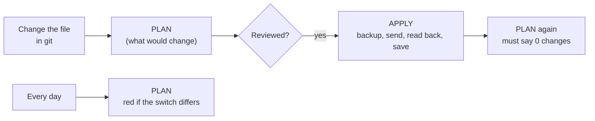

# Lab 3: Run the fabric as code

> **Version 0.2.0 · draft · 2026-11-18** · class/guides/03-fabric-as-code.md

## What you will learn

The loop the lab uses for every switch: plan, apply, read back, catch drift. You follow one change through it, see a hand change
caught the next morning, and read the performance and hardware data the same tooling collects.

**Time:** 30 minutes · **Before you start:** [Lab 2](02-ui-versus-code.md) done

## How the lab is set up for this lab

The live fabric is managed by a pipeline in the lab's network repository. The instructor shows its runs: a plan, an apply, a daily
drift plan. The pipeline shape is in [`fabric-as-code.example.yml`](../downloads/fabric-as-code.example.yml). [Lab diagram](lab-diagram.md).

<!-- 🎬 video slot 03-fabric-as-code: a plan run, an apply run, a red drift run and its fix -->
<video controls preload="metadata" playsinline width="100%" poster="img/03-fabric-as-code.jpg">
  <source src="img/03-fabric-as-code.mp4" type="video/mp4">Your browser does not play this video.
</video>
🎬 *Lab 3: run the fabric as code. Watch it, then follow the same steps below.*

---

## The loop

## 3.1 Plan

A run that only **plans**: the lines it would send, and nothing sent.

## 3.2 Apply

The run backs up the configuration, sends **only the missing lines**, reads every line back, then saves. If the read-back fails,
nothing is saved, and the backup is still the last good copy.

## 3.3 Prove it is idempotent

Run the plan again. It must report **0 changes**. If it doesn't, the code is wrong, not the switch.

## 3.4 Drift

Someone changes the switch by hand (on this fabric it was tested by setting a location string). The next daily plan turns red and
names the line. The next apply puts it back.

## 3.5 Performance and features

From the snapshot: `show interfaces counters` and `counters errors`, LACP partners in `show linkagg port`, `show fan`,
`show temperature`, `show power-supply`, `show ntp status`. The same data feeds the lab's health dashboard.

!!! question "Think about it"
    Why does the pipeline never delete a line it doesn't know about, but only report it?

!!! success "Done when"
    You can name the four stages of the loop, and say what a red daily plan means.

## Thank you

The read-only client the lab uses is [`aos_readonly.py`](../downloads/aos_readonly.py) (Toolkit T.3). ALE's switches expose the
same data through the AOS Web Services REST API described in the AOS 8 Switch Management Guide.

## Bonus

Read the `ALLOW` list in `aos_readonly.py`. Which command would you add for a capacity report, and what risk do you check before adding it?
