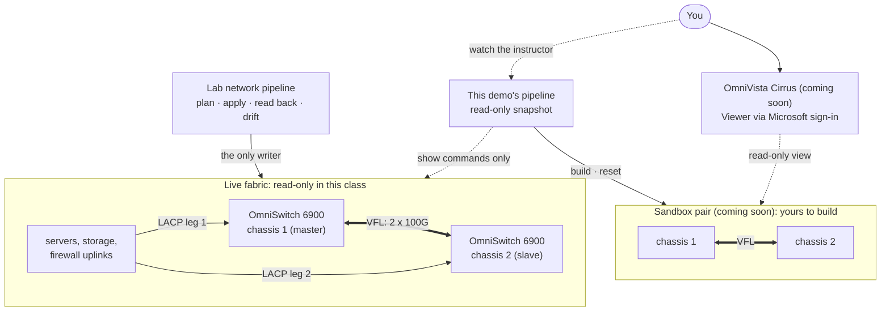

# Lab diagram

> **Version 0.1.0 · draft · 2026-11-18** · class/guides/lab-diagram.md

| Box | Who may change it |
|---|---|
| Live fabric | only the lab's network pipeline, after review |
| Sandbox pair | this demo's pipeline, the instructor, and you during Lab 2 |
| OmniVista Cirrus | Viewer for you, Admin for the instructor |
