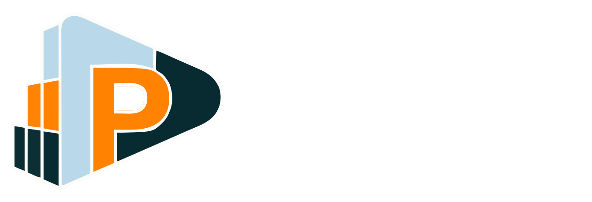

<!--
  START HERE: the welcome splash. REQUIRED on every class site, always the landing page (index.md). Keep the structure and the
  order; change the ✏️ text. 🏷️ lines are Paragon logos/credit: remove them if the demo cannot carry Paragon marks.
  Standard: core-web docs/class-sites.md.
-->

{ .pm-wordmark }
<!-- 🏷️ Paragon wordmark: remove if the demo cannot carry Paragon marks (or use the logo the demo is allowed to show). -->

Paragon Micro lab · student guide
  <!-- 🏷️ without Paragon marks: "Student guide" -->

# Alcatel-Lucent: HA switching, built in the UI and in code

Welcome, and thank you for joining us. Today you tour a live, highly available Alcatel-Lucent OmniSwitch fabric, see how it was built by hand and how the same build is written as code, and see how a lab runs that fabric as code every day, without anyone touching it by hand.

[Begin: Lab 0](guides/00-access-and-tools.md){ .md-button .md-button--primary }
[Read the student guide](student-guide.md){ .md-button }

## Start here

**1 · Get your login**

Your instructor gives you one username and password. It opens everything in this class.

**2 · Read the student guide**

The [student guide](student-guide.md) explains how the class works and lists the labs in order, with their times.

**3 · Do Lab 0**

[Lab 0](guides/00-access-and-tools.md) takes about 10 minutes: sign in everywhere and check your tools.

## What you will do

- Read the health of a two-chassis OmniSwitch **Virtual Chassis**: who is master, whether the stack links are up, whether both chassis agree
- Follow each HA build step twice: **at the console**, then **as code** that a pipeline applies and checks
- See how a fabric is run **as code**: plan, apply, read-back, drift, and why nothing is ever changed by hand
- *(coming soon)* Review the same switches in **OmniVista Cirrus**, ALE's cloud management service, signed in with your Microsoft account

## What you need

- A web browser. That is all: every lab is read-only, and the instructor drives the live switch on screen. The [command cheat sheet](downloads.md) is optional.
- Your login from the instructor. **This site never contains passwords**, and you never need to type one into it.

## Get help

!!! tip "Stuck for five minutes? Ask."
    Your **instructor** can reset your login, catch you up, or show any step on the big screen. See [Get help](help.md)
    for everything else.

---

<small>This class is designed and delivered by **Paragon Micro**, in the Paragon Micro lab. [Who we are →](https://www.paragonmicro.com/)</small>
<!-- 🏷️ Paragon credit: remove if the demo cannot carry Paragon marks, or credit as the demo's agreement requires. -->
