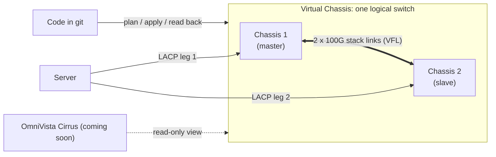

# Student guide

## What you will learn

A data centre switch pair has two jobs: carry traffic, and keep carrying it when one switch fails. Alcatel-Lucent Enterprise (ALE)
does this with a **Virtual Chassis**: two OmniSwitches joined by stack links that act as one switch with one configuration. You will
read that kind of fabric while it carries real traffic, follow how it was built, once by hand and once as code, and see how it is run
day to day: nothing is changed by hand, and every change is planned, applied by a pipeline and read back before it is saved.

## Your login, and what you need

Everything in this class is **read-only**. The switch you study is a working production fabric in the Paragon Micro lab, so:

| Resource | How you see it |
|---|---|
| The live switch | your instructor shows it on screen, read-only |
| Its state at the start of class | your instructor shows this booking's snapshot, captured read-only when the class was set up |
| The code that builds and runs it | shown on screen and on these pages |
| OmniVista Cirrus *(coming soon)* | your class login, through Microsoft sign-in, as a **Viewer** |

You never type a password into this site, and this site never shows one.

## How the lab is put together

Every server connects with **one cable to each chassis**, bundled with LACP. Lose a cable, a chassis or a stack link, and every
server still has a path.

## The labs, in order

| # | Lab | Time |
|---|---|---|
| 0 | [Access and tools](guides/00-access-and-tools.md) | 10 min |
| 1 | [Tour a live HA fabric](guides/01-tour-the-fabric.md) | 25 min |
| 2 | [Build it by hand, then as code](guides/02-ui-versus-code.md) | 40 min |
| 3 | [Run the fabric as code](guides/03-fabric-as-code.md) | 30 min |
| 4 | [OmniVista Cirrus: the SaaS view](guides/04-omnivista-cirrus.md) *(coming soon)* | 20 min |

**Reference, open beside every lab:** [Lab S: how this lab was built](guides/setup-how-the-lab-is-built.md) (every step at the console
and as code) · [Toolkit](guides/toolkit.md) (commands, snapshot, code) · [Lab diagram](guides/lab-diagram.md). Every lab page opens with a
🎬 walk-through recording: watch it, then follow the steps. The files are on [Downloads](downloads.md).
